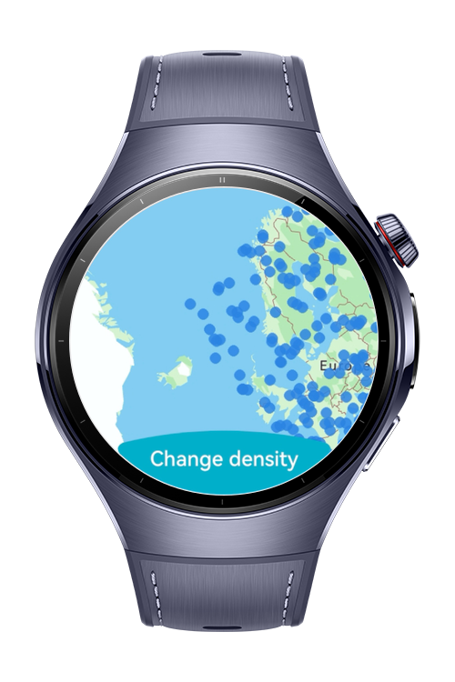
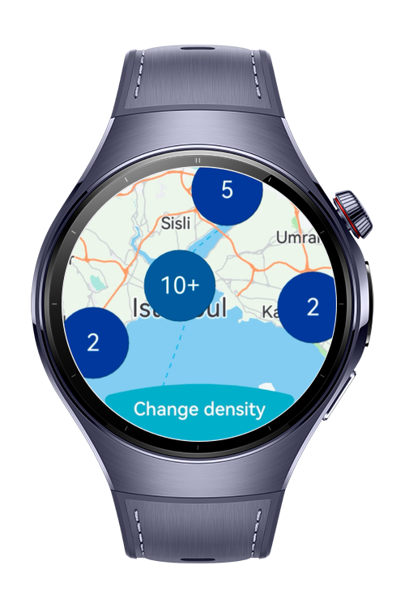
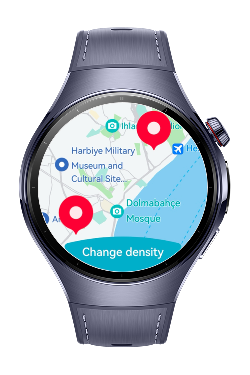
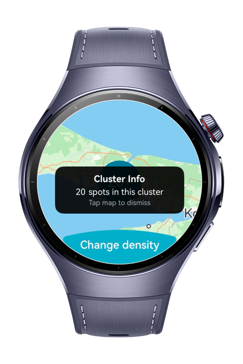

> **Note:** To access all shared projects, get information about environment setup, and view other guides, please visit [Explore-In-HMOS Index](https://github.com/Explore-In-HMOS/hmos-index).

# How to Build POI Cluster Map

This codelab demonstrates how to build a **POI cluster map** for HarmonyOS wearable devices using MapKit. The watch app renders a full-screen map with two overlay layers a density dot layer covering a cluster marker layer for neighborhoods and demonstrates custom info window rendering via MarkerDelegate.

# Preview

<div>
  
  
  
  
</div>

# Use Cases

- Display a large number of raw POI dots on a map using `MassPointOverlay`
- Group nearby POIs into tap-able cluster markers using `ClusterOverlay`
- Receive cluster tap metadata (count, position) via `MarkerClusterInfo`
- Render a custom info window on a cluster marker using `MarkerDelegate` as a `@BuilderParam`
- Animate the camera smoothly to a cluster center on tap
- Toggle the density dot layer on/off via `setVisible` / `isVisible`

# Technology

## Stack

- **Language**: ArkTS
- **UI Framework**: ArkUI
- **Tools**: DevEco Studio 5.1.0 or later
- **Libraries & Kits**:
    - `@kit.MapKit` — MapComponent, ClusterOverlay, MassPointOverlay, MarkerDelegate
    - `@kit.ArkUI` — ArcButton, ArcButtonOptions, ColorMetrics

## Required Permissions

- `ohos.permission.INTERNET`

# Directory Structure

```
entry/
├── src/
│   └── main/
│       ├── ets/
│       │   ├── entryability/
│       │   │   └── EntryAbility.ets
│       │   ├── entrybackupability/
│       │   │   └── EntryBackupAbility.ets
│       │   ├── model/
│       │   │   └── MockPoiData.ets
│       │   └── pages/
│       │       └── Index.ets
│       └── resources/
│           ├── base/
│           │   ├── element/
│           │   ├── media/
│           │   └── profile/
│           ├── dark/
│           └── rawfile/
│               ├── dot.png
└── module.json5
```

# Constraints and Restrictions

## Supported Device

- Huawei Watch 5

### Map Kit Setup Required

Map Kit must be enabled in AppGallery Connect.

### Minimum API Version

| API | Min version |
|---|---|
| `MassPointOverlay` | 6.0.0 (20) |
| `ClusterOverlay`, `MarkerClusterInfo` | 5.0.0 (12) |

# License

**How to Build POI Cluster Map** is distributed under the terms of the MIT License.  
See the [LICENSE](./LICENSE) for more information.